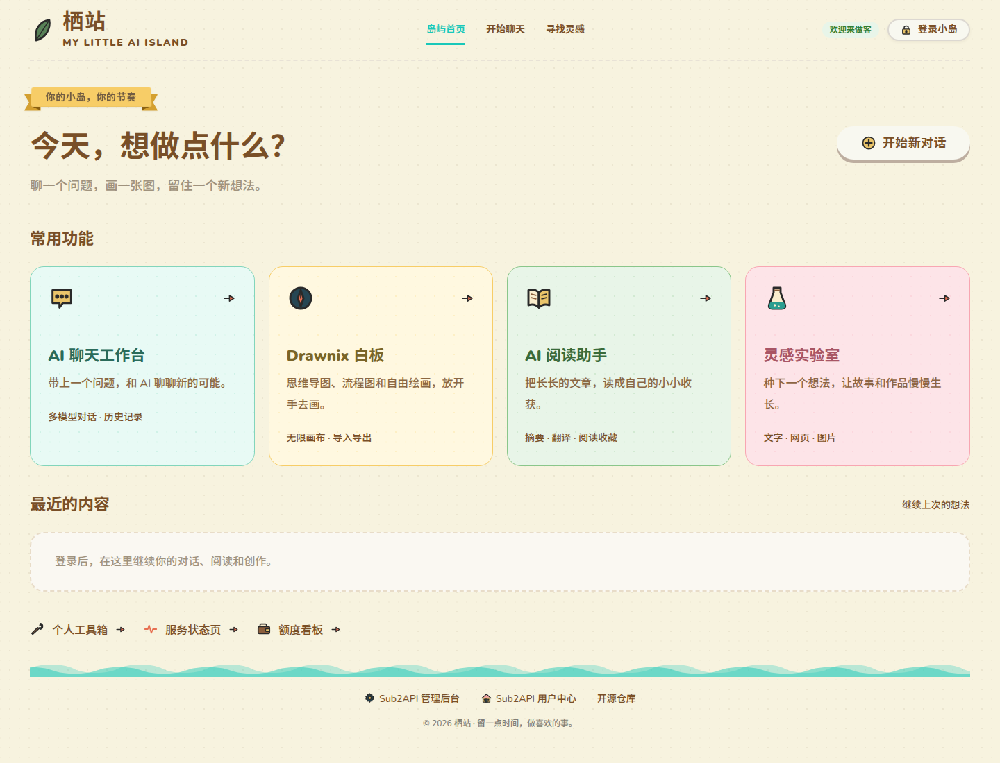

# 栖站 · Personal AI Portal

一个域名下的轻量个人 AI 工作空间。Go + SQLite + React + Animal Island UI，独立容器部署，与已有 Sub2API 共存，保留客户端的 `/v1` 地址。



前端直接采用 [Animal Island UI](https://github.com/guokaigdg/animal-island-ui) 官方组件，并遵循其 [官方 skill](https://github.com/guokaigdg/animal-island-ui/blob/main/skills/animal-island-ui-style/SKILL.md)。图标使用 `naive-icons`；设计与许可证说明见 [docs/UI.md](docs/UI.md)。

## 功能与路由

| 路径 | 功能 |
| --- | --- |
| `/` | 统一导航主页、服务概况、账号数量、Sub2API 入口 |
| `/chat/` | 模型选择、连续对话、聊天历史、提示词收藏 |
| `/tools/` | JSON 格式化/压缩、时间戳转换、逐行文本对比、二维码生成/下载 |
| `/read/` | 文章摘要、翻译、观点分析、收藏与下载 |
| `/lab/` | 故事、文案、单文件网页、图片生成与作品保存 |
| `/status/` | 内存、系统负载、运行时间、数据磁盘、服务健康与响应延迟 |
| `/quota/` | 接入现有额度服务，显示账号 5 小时/7 天剩余额度 |
| `/portal-login/` | 个人空间独立登录 |
| `/portal-api/` | 个人站内部接口 |
| `/portal-assets/` | 个人站静态资源 |

`/v1/*`、`/api/*`、`/admin/*`、`/login`、`/assets/*` 及其余已有路径仍由原应用提供。本项目不移动或修改 Sub2API 的数据库与程序。个人站账号与 Sub2API 账号独立。

## 部署

需要 Docker Compose，以及已经提供 HTTPS 的反向代理。生产环境默认单个所有者，不是多人 SaaS。

```sh
git clone https://github.com/motoneko/personal-ai-portal.git
cd personal-ai-portal
cp .env.example .env
chmod 600 .env
# 编辑 .env：设置域名、强随机登录密码、模型密钥和 Docker 网络名称
# 生成密码可使用：openssl rand -base64 30
docker compose up -d --build
```

容器仅绑定 `127.0.0.1:8090`，默认限制 160 MB 内存。前端构建工具和 Go 编译器只存在于构建阶段；运行镜像使用 scratch，非 root，无 shell、无 Docker socket。

| 环境变量 | 含义 |
| --- | --- |
| `PORTAL_ORIGIN` | 完整 HTTPS 来源，例如 `https://portal.example.com`，不要加尾部 `/` |
| `PORTAL_PASSWORD` | 至少 10 字符的强随机空间密码；只存在于服务端 |
| `PORTAL_API_KEY` | 上游模型密钥；不会下发到前端 |
| `PORTAL_MODEL` | 默认文本模型，默认 `gpt-6.1-sol` |
| `PORTAL_IMAGE_MODEL` | 图片生成模型，默认 `gpt-image-1`，需上游支持 |
| `UPSTREAM_URL` | Sub2API 内网地址，不带 `/v1` |
| `QUOTA_URL` | 现有只读额度服务内网地址 |
| `PORTAL_NETWORK` | 已存在的 Docker 网络名称 |
| `PORTAL_SECURE_COOKIE` | 生产保持 `true`；本机 HTTP 开发可设为 `false` |
| `PORTAL_DB` | SQLite 路径，容器默认 `/data/portal.db` |

模型发现使用 `GET /v1/models`；文本生成使用 `POST /v1/responses`，发送 `store:false`；图片使用 `POST /v1/images/generations`。实际模型可用性、图片能力和计费由上游账号决定。前端展示完整生成结果，等待期间发送 JSON 空白心跳，避免代理空闲超时；最多同时执行两个生成任务。

### HAProxy 集成

先确认已有前端定义 `sub2api_host` ACL，并存在 `use_backend sub2api_app if sub2api_host`。检查脚本后执行：

```sh
sudo python3 deploy/configure-haproxy.py /etc/haproxy/haproxy.cfg
```

脚本会备份配置、添加精确首页和独立路径分流，验证配置后平滑 reload。既有订阅/WebSocket 等路由不被覆盖。HTTP 个人站入口跳转 HTTPS，支持 Cloudflare 通过 `X-Forwarded-Proto` 传递原始协议。请确保入口代理正确设置该头。

其他 HAProxy 布局应人工参考脚本调整，不能直接覆盖整个现有配置。更换上游版本时先确认新路由未与这些路径冲突。

### 额度服务契约

额度服务需提供 `/health` 和 `/api/accounts`。后者返回：

```json
{
  "accounts": [{
    "id": 1, "name": "Example", "platform": "openai", "status": "active",
    "fiveHourRemaining": 75, "fiveHourResetAt": "2026-11-18T12:00:00Z",
    "sevenDayRemaining": 50, "sevenDayResetAt": "2026-11-23T00:00:00Z",
    "usageUpdatedAt": "2026-11-18T09:00:00Z"
  }],
  "generatedAt": "2026-11-18T09:00:00Z"
}
```

未知额度使用 `null`，不要伪造 0。未部署额度服务时，该模块会明确显示不可用，其余功能正常。项目不直接读取 Sub2API 数据库，也不包含其凭据或第三方看板源码。

## 数据与安全

- 首页和工具箱公开；聊天、收藏、图片、状态和额度接口必须登录。
- PBKDF2-SHA256 验证空间密码，随机会话 token 只以哈希存储；Cookie 为 HttpOnly、Secure、SameSite=Strict，七天过期。
- 写操作检查完整 Origin 和 JSON 内容类型；登录全局限制为每分钟十次，生成限并发。
- 工具箱输入不上传；AI 输入会发到配置的上游。聊天在成功回复后自动保存，阅读/作品按“保存”后持久化。
- SQLite、图片存在独立 named volume；base64 图片保存到私有图片接口。外部图片 URL 的有效期由上游决定。
- 网页作品只在带 sandbox 的 iframe 内预览，禁止网络请求、表单提交和同源权限；下载 HTML 后在外部打开不再受站点预览限制。
- 只读 `/proc` 用于采集主机负载、内存和运行时间；不挂载 Docker socket。磁盘指数据卷所在文件系统。服务响应时间不是模型生成速度。
- 模型响应按文本呈现，避免把不可信 HTML 直接注入站点。
- 图片文件在删除收藏时不会自动清理，以免删掉其他收藏引用；应定期管理容量并备份数据卷。

此项目默认小规模个人使用。已有系统的直接端口暴露、Cloudflare 策略及 Sub2API 账号权限应由站点所有者自行维护。

## 开发与测试

需要 Go 1.27 和 Node.js 24：

```sh
npm ci
npm run build
go test ./...
PORTAL_PASSWORD='replace-with-a-long-dev-password' \
PORTAL_ORIGIN=http://127.0.0.1:8090 PORTAL_SECURE_COOKIE=false \
PORTAL_LISTEN=127.0.0.1:8090 PORTAL_DB=/tmp/portal-dev.db go run .
```

浏览器测试需要 Chromium：

```sh
npx playwright install --with-deps chromium
PORTAL_TEST_PASSWORD='replace-with-a-long-dev-password' npm run test:ui
```

测试覆盖首页导航、移动端布局、四种工具、登录/退出、聊天持久化、提示词、阅读收藏、网页隔离预览、状态/额度展示和文本转义。浏览器测试使用 mock 模型请求，避免 CI 产生费用；部署后应另做真实上游 smoke test。测试会在指定实例创建记录，只对测试实例运行。

## 备份、更新与回滚

```sh
# 暂停个人站后备份 SQLite、图片和会话，避免 WAL 拷贝不一致
docker compose stop portal
container_id=$(docker compose ps -aq portal)
docker cp "$container_id:/data" ./data-backup
docker compose start portal
# .env 单独备份到受保护的位置，不提交到 Git

# 更新
git pull --ff-only
docker compose up -d --build
```

回滚个人站时，可重新部署旧版本镜像；若需要完全恢复原入口，将 HAProxy 备份复制回原路径，执行 `haproxy -c -f /etc/haproxy/haproxy.cfg` 后 `systemctl reload haproxy`。不要使用 `docker compose down -v`，它会删除个人站数据卷。

改密码后需要撤销既有会话时：停服务，备份数据库，使用 SQLite 执行 `DELETE FROM sessions;`，再启动服务。

## 开源

MIT License。界面与服务端为独立实现，通过公开兼容 API 与 Sub2API 集成。运行配置、密钥、账号数据、证书和生产备份均不属于仓库内容。

## Drawnix 白板

`/draw/` 集成开源 [Drawnix](https://github.com/plait-board/drawnix)，在浏览器中运行，和 Portal 共用容器。编辑器单独打包、按页面加载，不增加首页的脚本体积。支持思维导图、流程图、自由绘画，以及上游的导入导出功能。

登录后读取私人白板；点击“保存到小岛”将当前白板保存在服务器 SQLite 中，换设备登录后可以继续。当前提供一张持久白板，保存是手动触发的；请避免多设备同时覆盖编辑。离开前有未保存修改会触发浏览器提醒。单张白板保存上限 1.5 MB（包含内嵌图片）；大型白板可通过 Drawnix 菜单导出 `.drawnix` 备份。

已有部署可运行 `sudo python3 deploy/enable-drawnix.py /etc/haproxy/haproxy.cfg` 更新路由（自动备份、检查并重载）。

代理需将 `/draw` 和 `/draw/` 前缀转发到 Portal；`/v1` 和 Sub2API 路由保持原配置。`/draw/editor` 需要登录且只允许本站嵌入。

Obsidian 官方同步的只读接入设计见 [方案](docs/OBSIDIAN.md)，尚未启用。

## 登录防爆破与邮件告警

支持 Fail2Ban 按登录失败日志封禁、可信代理真实 IP 识别、持久封禁、SMTP 告警队列及全局邮件冷却。该功能需在主机安装 Fail2Ban 并配置 SMTP，单独启动 Compose 不会自动安装或启用邮件通道。详见 [部署与维护说明](docs/SECURITY-LOGIN.md)。
